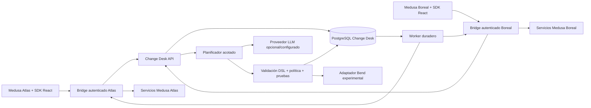

# Arquitectura del SDK Change Desk

Estado: especificación para implementar; no describe un sistema desplegado ni resultados medidos. Fecha de investigación: 2026-10-24. Las decisiones de `00-DECISIONS.md` y los contratos de `../contracts/` prevalecen ante discrepancias.

## 1. Resultado y fronteras

El entregable es un SDK integrable y un servicio que convierte una petición en una receta declarativa validada, muestra un plan concreto, recibe aprobación y ejecuta capacidades autorizadas del backend. La primera integración es Medusa. Una receta reutilizable NO contiene datos de productos, identificadores privados de otra tienda, credenciales, URLs de servicios ni código ejecutable generado.

La demo canónica `catalog.campaign.prepare.v1` añade productos publicados a una categoría de campaña existente y a un canal de ventas existente. Conserva las relaciones ya presentes, etiquetas, estado, precios e inventario. La categoría y el canal son parámetros resueltos en la tienda receptora. No cambia un producto draft a published. No se usa actualización de un array de etiquetas: su semántica de reemplazo podría eliminar relaciones ajenas.

Atlas y Boreal son DOS instancias Medusa con bases de datos independientes. Un canal comercial de Medusa no es un tenant. Distintos usuarios en Atlas prueban permisos y colaboración; Atlas frente a Boreal prueba aislamiento y reutilización de implementación sin compartir datos.

Además de la receta principal, el MVP admite `catalog.category.assign.v1` (solo categoría) y `catalog.channel.assign.v1` (solo canal). Son funciones diferentes sobre el mismo catálogo finito, no simples paráfrasis del mismo prompt. Sus parámetros y permisos son el subconjunto que utiliza cada receta; no pedir acceso a canal para una función que solo añade categoría.

## 2. Topología mínima

Los bridges son una extensión pequeña instalada en cada backend Medusa, no proxies que acepten URLs arbitrarias. UI, servidor y worker comparten contratos, pero cada frontera vuelve a validar entradas. Las credenciales Medusa y del proveedor LLM nunca se transfieren al navegador.

Despliegue local mínimo:

- Un único source/build/imagen `apps/service` con dos entrypoints: proceso API para autenticación, solicitudes, catálogo, planes, aprobaciones, historial y límites; proceso worker para generación y ejecución. No son dos servicios de código ni dos imágenes. La generación no debe bloquear el event loop de la API ni ocupar el cupo de ejecución de negocio.
- Un PostgreSQL para los datos Change Desk. No se introduce Redis ni Temporal como requisito del MVP.
- Dos servidores Medusa y dos bases separadas. Pueden compartir un servidor PostgreSQL local con bases/roles diferentes; no se comparte conexión con privilegios cruzados.
- Un adaptador de proveedor falso determinista para tests de CI y uno real configurado para la demostración de lenguaje natural. El falso no acredita resistencia del LLM a ataques.

En producción futura, el runner puede desplegarse junto al backend del cliente, con tráfico privado. El laboratorio local no acredita ese despliegue, alta disponibilidad ni miles de tenants. La frontera del adaptador hace posible cambiar la topología después sin cambiar la semántica de aprobación o autorización.

## 3. Cuatro workspaces y dependencias mínimas

Usar TypeScript, una versión exacta de Node LTS compatible con el pin Medusa y pnpm con lockfile. P0 fija esa versión tras probarla; no se copia `latest` en CI. El perfil normativo completo está en `../contracts/technology-profile.json`.

| Workspace fuente (exactamente cuatro) | Responsabilidad | No puede hacer |
|---|---|---|
| `apps/service` | API y worker entrypoints; módulos internos core, policy, storage, planner, adapter, evals y laws | Convertir módulos internos en paquetes/despliegues o ejecutar código del modelo |
| `packages/contracts` | JSON Schema 2020-12, tipos TypeScript públicos, errores y versiones | Importar Medusa/DB; arrastrar Ajv al navegador mediante imports de tipos |
| `packages/sdk-react` | Launcher/UI lazy, cliente con `fetch`, `crypto` y `AbortController`; React como peer | Guardar secretos, duplicar política como única defensa o incluir Ajv/SDK Medusa por defecto |
| `packages/medusa-plugin` | UI host, bridge, guard nativo y capacidades Medusa estrechas | Exponer tokens privilegiados, aceptar endpoint dinámico o SQL del planner |

Esta distribución es vinculante. Core, policy, storage, planner, adapter, evals y laws son directorios/módulos internos de `apps/service`, no workspaces, paquetes npm, imágenes ni procesos adicionales. Fixtures, scripts, docs e infraestructura de desarrollo tampoco son workspaces. Hay un solo source/build Medusa que se ejecuta dos veces con configuración Atlas/Boreal, bases, roles y secretos distintos; esas instancias no son workspaces. Las dependencias propias del host Medusa se miden aparte y no se atribuyen como overhead añadido por el SDK.

Dependencias runtime propias iniciales: Fastify, `pg` y Ajv 8 usando explícitamente el compilador Draft 2020-12. Los defaults de dialecto de Fastify pueden diferir y deben verificarse con tests en implementación. Usar `jose` para JWT estándar únicamente si las primitivas verificadas del host/runtime no bastan. En navegador usar primitivas nativas. Sin ORM/query builder, contenedor DI, LangChain, embeddings, Redis, Temporal, librería de colas o runtime genérico de agentes. Build con scripts pnpm, `tsc -b` y Vite solo donde lo exija browser/librería o el tooling de Medusa.

Ajv documenta que su export default usa draft-07 y que draft 2020-12 requiere la clase específica; Fastify muestra configuración de validación con draft-07 y compila schemas a funciones. Por ello solo schemas developer-owned y revisados se compilan. Recetas y UI procedentes del modelo son **datos** validados contra schemas conocidos; nunca se compila un schema aportado por usuario/modelo como código de validación. [Ajv: versiones de JSON Schema](https://ajv.js.org/json-schema.html) y [Fastify: validación/serialización](https://fastify.dev/docs/latest/Reference/Validation-and-Serialization/).

## 4. Contrato de integración de la app

El proveedor de una app instala cuatro elementos:

1. **Identidad:** una ruta en su backend verifica la sesión real y emite una sesión Change Desk corta con issuer, audience, actor, tenant, app installation, expiración y versión de política. El navegador no decide esos campos.
2. **Capacidades:** un manifiesto versionado con nombre estable, esquemas de entrada/salida, permisos, lectura/escritura, precondiciones, efectos, límites y política de reintento/reconciliación. Las implementaciones son código revisado del conector.
3. **Puntos de interfaz:** un componente del SDK en una zona admitida y un renderer de componentes permitidos. Integrar no significa modificar todo el DOM ni escanear una web para inferir autoridad.
4. **Política de efectos:** el host revalida actor, recursos y permiso en cada operación, incluso después de aprobar el plan. Un actor deshabilitado no puede seguir escribiendo mediante un job antiguo.

La API pública normativa del SDK es `ChangeDeskConfig` en `10-API-AND-SDK.md`; este documento no mantiene una interfaz duplicada. En particular, `getContext` es síncrono y devuelve selección/surface, y la extensión observable única es `onEvent?: (event: SafeUiEvent) => void`. Cambiar esa forma exige versionar el contrato, no inventar callbacks paralelos en arquitectura.

`HostContext` puede incluir pantalla, tipo de recurso y selección. El servidor vuelve a resolver y autorizar esas referencias. No se usan objetos completos del DOM como instrucciones de sistema. Las opciones visuales no pueden habilitar permisos.

Roles normativos del piloto: `admin` administra instalaciones, publicación y revocación; `requester` pide funciones y consulta previews pero no aprueba escrituras; `operator` prepara, aprueba y ejecuta instalaciones habilitadas; `viewer` solo lee lo autorizado. Son políticas de nuestro bridge, no una afirmación de RBAC granular nativo de cualquier edición Medusa. Las rutas nativas que permitirían a un usuario demo eludir estas restricciones también deben protegerse y probarse. Si cambia el actor responsable de una ejecución respecto al plan preparado, el servidor genera el plan bajo ese nuevo actor y obtiene su aprobación; no reutiliza una autorización ajena.

Objetivo verificable de integración: instalar el paquete/plugin, registrar identidad y capacidades, y montar una zona UI; medir archivos modificados, líneas de glue propias y tiempo desde un repositorio limpio. La primera integración Medusa incluye más trabajo porque crea el conector reutilizable. No prometer una línea de código para una app que no tiene API o permisos adecuados.

## 5. Separar descubrimiento, generación y ejecución

**Descubrimiento:** índice de manifiestos autorizados. Búsqueda exacta/estructurada primero. La similitud semántica, si se incorpora, solo ordena candidatos visibles. No certifica equivalencia ni compatibilidad.

**Generación:** el modelo recibe el objetivo, esquemas de capacidades permitidas y contexto mínimo. Puede pedir lecturas autorizadas, proponer parámetros y emitir un borrador de DSL. Un parser estricto rechaza campos desconocidos, límites excedidos y referencias ilegales. El modelo no emite un plan ya aprobado ni una credencial.

**Compilación y verificación:** el servidor normaliza el borrador, fija versiones, resuelve referencias locales, ejecuta validación estática/política y prepara pruebas. Los pasos tienen efectos declarados. Una capacidad no disponible produce `CAPABILITY_MISSING`, una propuesta de cambio de código revisable fuera del runtime, o una alternativa explícita al usuario. No se fabrica un endpoint inexistente.

**Planificación concreta:** para parámetros y selección actuales se calcula un plan privado por registro. La selección resuelta queda acotada y materializada. La aprobación firma ese plan y sus condiciones, no solamente una frase del chat.

**Ejecución:** el worker interpreta el DSL aprobado. No consulta al modelo para decidir el siguiente endpoint. Cada resultado se valida y se persiste; los efectos ambiguos se reconcilian.

**Reutilización:** la receta genérica se publica con consentimiento separado; cada cliente recibe una instalación privada con configuración y permisos. Una nueva ejecución utiliza la misma receta versionada con un nuevo plan y aprobación cuando tiene escrituras.

## 6. DSL y renderer

El contrato de `../contracts/` es la autoridad. La implementación debe mantener estas restricciones aunque amplíe sus tipos:

- Máximo inicial de 12 definiciones de pasos y 100 registros seleccionados por ejecución; comprobar presupuesto total expandido antes de admitir el trabajo.
- DAG acíclico. Dependencias estáticas por identificador de paso. En MVP, `forEach: selectedProducts` es un mapa acotado explícito; `dependsOn` se resuelve dentro del mismo registro. No hay loops abiertos, recursión, expresiones evaluables ni llamadas generadas dinámicamente.
- Referencias tipadas a parámetros y recursos seleccionados; no interpolación de strings para shell, código, HTML, SQL o URL.
- Capacidades pertenecen a una allowlist registrada. Una acción de lectura no puede declarar ni efectuar una escritura oculta; los tests del adaptador comprueban la distinción.
- Los resultados de herramientas son datos no confiables. No pueden cambiar políticas, generar pasos posteriores no aprobados ni reemplazar instrucciones del planificador.
- Un esquema UI admite tipos cerrados: texto escapado, campo tipado, selector de recurso autorizado, tabla, estado y botón de acción. No admite scripts, estilos globales, HTML crudo, iframes ni handlers arbitrarios.
- Mensajes y etiquetas del modelo se escapan como texto. Los enlaces opcionales se validan contra una política explícita y nunca contienen secretos ni URLs que el runner deba ejecutar.

La primera UI no es un constructor universal de aplicaciones. Es una superficie acotada capaz de añadir acciones y formularios de negocio al panel. Mantener esa frontera permite medir fiabilidad y coste antes de incorporar nuevos componentes.

## 7. Transporte y sesiones

Contrato HTTP versionado bajo `/v1`, errores estructurados con `code`, `requestId`, mensaje seguro y detalles permitidos. Las rutas exactas se fijan en los contratos raíz. Conceptos necesarios: crear solicitud; leer candidatos; seleccionar/configurar candidato; preparar plan; aprobar plan; iniciar/consultar/cancelar ejecución; instalar función; solicitar publicación/revocación; leer evidencia autorizada.

Toda mutación debe tener idempotency key dentro del ámbito de tenant+actor+operación; reutilizar la misma clave con otro cuerpo devuelve conflicto. La sesión del navegador dura poco y se renueva mediante el host. Un ticket de ejecución delegado está ligado a aprobación/plan/actor/tenant y tiene su propia expiración; no prolongar silenciosamente una sesión del usuario para continuar escribiendo indefinidamente.

Para el MVP, polling con cursor/ETag, backoff, pausa si no hay trabajo y cancelación al desmontar es suficiente. Evitar WebSockets/SSE obligatorios y no abrir un canal por cada botón guardado. La desconexión del navegador no borra un job ya autorizado; la expiración o revocación de su autoridad sí impide iniciar nuevos efectos.

El bridge de Medusa se autentica también como servicio con identidad propia, pero esa identidad no sustituye al actor. Cada comando lleva el contexto de ejecución firmado y acotado; el host resuelve el usuario actual y su permiso. Los detalles de implementación deben seguir `03-MEDUSA-INTEGRATION.md`. Una API key administrativa global no constituye autorización por usuario.

## 8. Decisiones de baja complejidad y coste

- Cuatro workspaces, un artefacto/imagen de servicio con dos entrypoints. Ningún microservicio por capacidad ni contenedor por usuario.
- Un PostgreSQL para catálogo, sesiones internas, jobs y evidencia pequeña. Objetos grandes pueden salir a un almacén de objetos mediante una interfaz posterior; no cargar blobs de trazas en cada consulta.
- Búsqueda exacta y filtros SQL antes de añadir embeddings. Índices y caché privados se dimensionan y se purgan.
- Validación estática antes de consumir tokens. Presupuesto de generación por solicitud, tenant y ventana temporal. El worker debe cortar la planificación que exceda ese presupuesto.
- Cero llamadas LLM durante la ejecución repetida de una receta aprobada. Una petición nueva expresada libremente puede necesitar clasificación; medirla aparte del coste de ejecutar una función ya instalada.
- SDK lazy: launcher ≤15 KiB gzip y panel lazy ≤150 KiB gzip son objetivos duros de aceptación todavía no medidos; ≤60 KiB para panel es stretch, no gate de release. Documentar peer dependencies y total all-in; no ocultar coste transferido a React/host.
- Progreso por polling HTTP (2 s activo, 10 s en segundo plano). SSE/WebSocket quedan fuera del API mínimo.
- Concurrencia inicial objetivo 2 ejecuciones por tenant y 4 globales por despliegue, además de un límite por backend; si hay varios procesos, la coordinación global vive en DB. Los valores se ajustan con datos, no por afirmación de capacidad.
- Hasta 100 trabajos pendientes por tenant como límite inicial de admisión; `429`/`Retry-After` o respuesta de cola llena, sin aceptación ilimitada en memoria.

## 9. Límites de confianza que no se deben borrar

Un servicio compartido con RLS no es aislamiento de proceso frente a un compromiso total de ese servicio. El MVP protege frente a usuarios/tenants, errores de autorización e instrucciones adversarias mediante controles verificables; no afirma resistencia a un atacante con credenciales de administrador de DB o ejecución remota en el worker.

Un hash no demuestra que un artefacto sea seguro. Una firma acredita procedencia e integridad. Una prueba Bend verifica una propiedad del modelo formalizado bajo sus supuestos, no todas las llamadas externas. Un `200 OK` del backend no demuestra que se preservaran todos los invariantes. Cada capa tiene evidencia y estado separado.

La capacidad de adicionar una relación no hace atómica una secuencia de dos sistemas. Si se añadió categoría pero no canal, la UI muestra parcial y el ledger permite continuar el paso seguro. No se compensan automáticamente cambios si hacerlo puede retirar una relación que otro actor necesita.

## 10. Evidencia para aceptar la arquitectura

Antes de declarar la integración terminada deben existir: instalación reproducible; dos stores reales con datos ficticios; pruebas del plugin y del bridge; cuatro roles distintos; captura de red que muestre ausencia de secretos en navegador; receta privada y publicación explícita; reutilización en otra tienda con parámetros locales; fallo parcial recuperado; permiso revocado durante un job; prueba de aislamiento con IDs conocidos ajenos; costes medidos; suite de ataques; resultado Bend honesto; y evidencia de que el panel Medusa sigue operando sin Change Desk.

## Fuentes oficiales y alcance de la investigación

- [Widgets Medusa](https://docs.medusajs.com/learn/fundamentals/admin/widgets): puntos de extensión React y empaquetado en plugins. Esto justifica la integración UI; no verifica nuestro plugin futuro.
- [Rutas protegidas Medusa](https://docs.medusajs.com/learn/fundamentals/api-routes/protected-routes): middleware y contexto de autenticación. Autenticación no implica que nuestros roles granulares ya existan.
- [Autenticación Admin API](https://docs.medusajs.com/api/admin/authentication): métodos de autenticación; fijar la versión antes de implementar para evitar mezclar cabeceras de v1 y v2.
- [PostgreSQL SELECT](https://www.postgresql.org/docs/current/sql-select.html): `SKIP LOCKED` sirve para consumidores de una cola; no entrega una vista general consistente ni fairness por sí solo.
- [PostgreSQL RLS](https://www.postgresql.org/docs/current/ddl-rowsecurity.html): políticas por fila y exclusiones de owner/superuser/BYPASSRLS. La política concreta y sus tests son trabajo pendiente.
- [Ajv JSON Schema](https://ajv.js.org/json-schema.html) y [Fastify Validation](https://fastify.dev/docs/latest/Reference/Validation-and-Serialization/): dialecto explícito y compilación restringida a schemas confiables.

Las cifras de coste, tamaño y concurrencia son objetivos propuestos. Ningún componente de este documento se ha ejecutado como parte del handoff.
