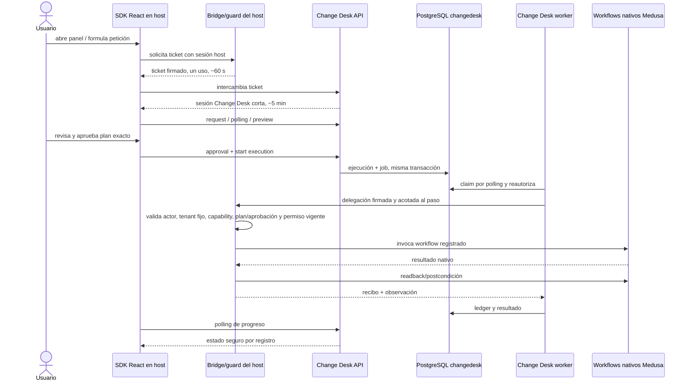

# Integración y despliegue: recorrido extremo a extremo

Estado: explicación del diseño existente; no describe una integración ya implementada ni añade servicios al perfil de `../contracts/technology-profile.json`.

## 1. Qué instala cada parte

La aplicación host integra dos paquetes:

- `packages/sdk-react`: launcher y panel lazy. Se monta en puntos de extensión soportados, renderiza componentes declarativos preinstalados y usa `fetch`, `crypto` y `AbortController` nativos. No recibe JavaScript remoto ni ejecuta HTML, schemas o URLs aportados por el modelo.
- `packages/medusa-plugin`: bridge backend, guard de rutas nativas y adapters de capacidades Medusa. Es la frontera confiable que conoce la sesión host y ejecuta únicamente operaciones registradas.

Change Desk despliega `apps/service` desde un solo source/build/imagen con dos procesos: entrypoint API y entrypoint worker. Ambos usan la base `changedesk` en PostgreSQL. Atlas y Boreal ejecutan el mismo source/build Medusa como dos instancias independientes, con bases, roles y secretos distintos. Un único servidor PostgreSQL local puede alojar `changedesk`, `atlas` y `boreal`, sin conceder acceso cruzado.

API y worker separados no son microservicios diferentes: comparten artefacto y módulos internos. El proceso separado evita que generación o recuperación bloquee la API.

## 2. Comunicación y confianza

Fuera de localhost, navegador, host y API usan HTTPS. El navegador habla con el bridge host para acreditar identidad y con la API para solicitudes, planes, aprobación y polling. El worker solo llama al origen host registrado por operadores; nunca acepta hostname, socket, SSH, ruta o credencial desde prompt/receta. En producción futura, API/worker y bridge pueden comunicarse por red privada, pero esa topología debe verificarse antes de afirmarla soportada.

El host valida en toda lectura y efecto: actor, tenant fijado por la instancia, capability/recurso, alcance, política, caducidad y permisos actuales. Las lecturas autorizadas de preview y readback no conceden escritura ni requieren una aprobación previa. Solo una llamada con efectos exige además un plan materializado, su hash aprobado y una delegación firmada/acotada al paso. Después el host invoca el workflow nativo y devuelve recibo/readback. Firmar una delegación protege integridad y alcance; no elimina TOCTOU ni demuestra que el backend aplicó el efecto. Por eso siguen siendo obligatorios reautorización, precondiciones, readback, reconciliación y guard de rutas nativas.

No hay API key administrativa en navegador. Endpoints, conexiones y secretos los configura un operador en servidor; el prompt no los elige. Si API, worker, bridge o backend no están disponibles, la operación falla cerrada o queda en estado tipado/reconciliable: no se transforma en éxito ni busca otra URL.

## 3. Qué cambia sin redeploy

Una receta nueva dentro de capacidades y componentes ya instalados es JSON declarativo validado. El servicio guarda artefacto, versión, hash, políticas/evidencia y catálogo privado; cada instalación guarda bindings/configuración privada. El SDK carga el schema UI permitido y renderiza selectores, formulario, preview, tabla y estado ya incluidos. Así puede aparecer una acción/formulario nuevo sin desplegar código y ejecutarse después sin LLM.

Esto no es mutación remota del source ni filesystem del host. Añadir una operación host, capability, componente UI o garantía que no existe exige código revisado, tests e instalación/deploy de una versión nueva del plugin/SDK/servicio. Nunca se descarga JS de una receta ni se inventa un endpoint.

Medusa sigue siendo la fuente de verdad para productos y relaciones. Change Desk conserva identidad, recetas, instalaciones, planes, aprobaciones, jobs, ledger, recibos y evidencia mínima; envía al modelo solo contexto necesario. Configuración privada no entra en catálogo compartido. Reutilización entre tiendas requiere publicación genérica opt-in, firma/confianza y bindings locales nuevos.

## 4. Integrar otro backend

Otra aplicación implementa el mismo patrón HTTP y de política: montaje UI, endpoint de identidad host, registro finito de capacidades, autorización por actor/recurso, ejecución estrecha y readback. No es un proxy genérico. El SDK React es el piloto; otros frameworks necesitarían un cliente/adaptador nativo posterior. Este handoff no afirma una integración universal ya implementada ni que cualquier app sea seamless sin mapear permisos, workflows y concurrencia.

Checklist mínimo:

1. Instalar/montar SDK y plugin en puntos soportados; configurar orígenes y secretos solo en servidor.
2. Mapear identidad/roles y registrar capacidades finitas con esquemas, permisos, efectos y readback.
3. Probar login, preview sin mutación, aprobación actor-bound, ejecución, polling, rutas nativas y fallos cerrados.
4. Medir glue, bundle, latencia y recuperación desde una instalación limpia antes de calificar la integración como sencilla.

Puede configurarse sin redeploy una receta dentro de los componentes/capacidades instalados. No puede añadirse código, UI arbitraria, endpoints, autoridad o acceso a otra instancia sin una entrega revisada. Los contratos normativos están en [API y SDK](10-API-AND-SDK.md), [integración Medusa](03-MEDUSA-INTEGRATION.md), [seguridad](04-SECURITY-AND-LAWS.md) y [ejecución/datos](07-EXECUTION-AND-DATA.md).
